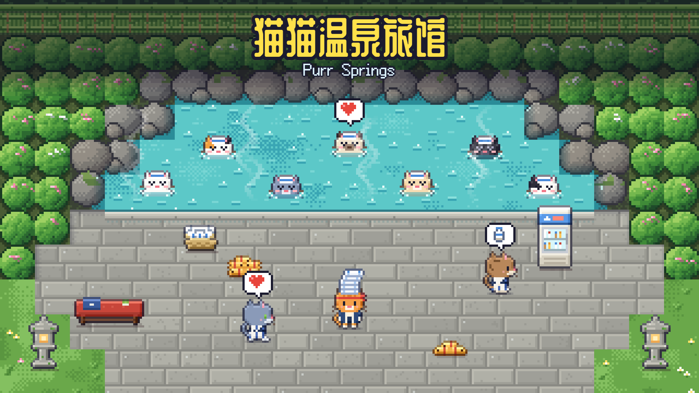

# 猫猫温泉旅馆 Purr Springs

开一家猫猫温泉旅馆：接客人、铺被子、送毛巾，一点点扩建。

**在线试玩：** https://grrreymane.github.io/PurrSprings/

## 怎么玩

- 按住屏幕任意处拖动＝摇杆走路（电脑上 WASD / 方向键），站到哪儿就自动干活。
- 站在柜台后面给客人办入住；踩一下地上的小鱼干堆就收钱；走进脏房间把被子铺好。
- 温泉开了以后，从大堂毛巾架顶一摞毛巾送到温泉的毛巾篮。
- 背着鱼干站进地上的虚线价格圈，就能扩建、雇员工；跟着黄色小箭头走就不会迷路。

## 内容

- 8 间客房、露天温泉（可扩建浴池）、牛奶机、跑鞋 ×3、竹篮 ×2
- 员工：前台三花猫、两位仲居白猫（打扫）、搬运灰虎斑（补毛巾）
- 10 种毛色的客人：泡汤、喝牛奶、换浴衣、睡觉、留小费
- 一星到五星，五星时弹出庆祝面板和带二维码的分享卡
- 和风背景音乐与音效全部用 WebAudio 合成，进度自动保存在本地

## 本地运行

整个游戏是一个 `index.html`，没有构建步骤，直接用浏览器打开即可（或 `python -m http.server` 后访问）。进度保存在浏览器本地存储里。

改了游戏里的文字后运行 `python D:/Minigame/_workflow/tools/subset_font.py .` 更新字体子集。

测试：`node D:/Minigame/_workflow/tools/headless.js . tests/smoke.js --seed 1`（冒烟），`tests/bot.js --seed N -- eager|casual`（平衡机器人）。
